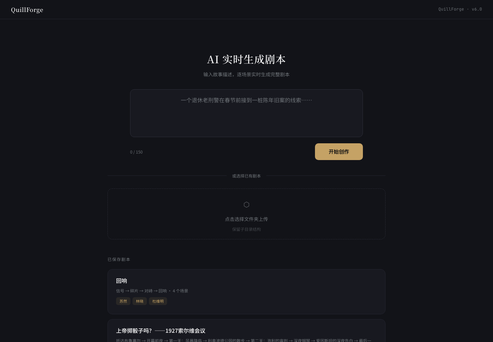
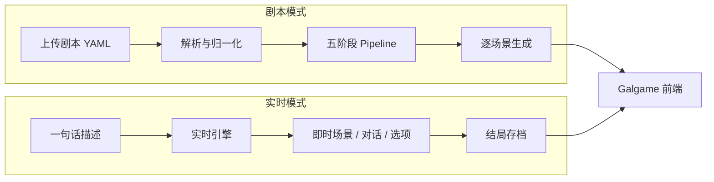
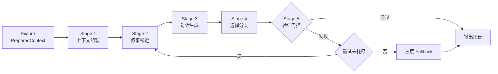

<p align="center">
  
</p>

<h1 align="center">QuillForge</h1>

<p align="center">
  <b>把一份剧本，变成一场可以玩的互动叙事。</b>
</p>

<p align="center">
  
  
  
  
</p>

QuillForge 是一个 **AI 驱动的互动叙事生成引擎**。它把「世界线、角色卡、场景、事件、结局」这类结构化剧本拆成可编排的生成阶段，逐场景产出旁白、对话与玩家选项；玩家的每一次选择都会被记录并注入后续生成，最终走向不同结局。

如果你手里已经有一部小说、跑团模组或游戏企划，QuillForge 可以把它变成可交互的视觉小说；如果只有一个念头，实时模式能让你用一句话直接开局。

### 它适合谁

- **叙事创作者**：把设定集变成可试玩的互动剧本
- **游戏原型团队**：快速验证一段 branching narrative 的手感
- **AI 应用开发者**：参考一个完整的 LLM 编排工程（SUT 隔离、阶段化 Pipeline、验证门控、SSE 流式、Fallback）

---

## 界面预览

| 创作台 | 互动剧场 |
|:---:|:---:|
|  |  |
| 一句话实时创作，或加载已有剧本 | Galgame 式演出：立绘、旁白、选项、TTS |

---

## 功能特性

| 能力 | 说明 |
|------|------|
| 五阶段 Harness | 上下文组装 → 叙事锚定 → 对话生成 → 选择分支 → 验证门控，阶段可插拔 |
| 选择驱动叙事 | 选择历史注入 Prompt，隐藏选项按条件解锁，结局按选择路径匹配 |
| 流式生成 | 旁白逐字、对话逐条、动作旁白穿插，SSE 实时推送 |
| AI 实时生成 | 一句话描述 → 实时分场景生成 → 选项 → 结局，无需预先准备剧本 |
| AI 剧本生成 | 一句话 → 世界书 / 角色 / 世界线 / 事件 / 结局的完整剧本包 |
| 美术素材 | 背景与立绘按需生成，线程池并行 + 磁盘缓存，无 Key 时自动降级 |
| 语音合成 | 音色克隆优先，失败回退预置音色，纯文字模式可运行 |
| 质量兜底 | 8 项验证检查 + 三层 Fallback，保证对话轮数与角色一致性 |
| 内置示例 | 回响-DEMO、索尔维0801 两套剧本，开箱即玩 |

---

## 两种使用模式



| 模式 | 输入 | 适合 |
|------|------|------|
| 剧本模式 | 结构化剧本目录（4 或 11 个文件） | 已有完整设定的长篇叙事、系列作品 |
| 实时模式 | 一句话描述（≤ 150 字） | 快速试玩、灵感验证、现场演示 |
| 剧本生成 | 一句话描述 | 产出一份可继续编辑的完整剧本包 |

---

## 技术栈

| 层 | 选型 |
|----|------|
| Web | FastAPI + uvicorn + slowapi |
| 模型 | openai SDK（兼容 DeepSeek / OpenAI / Azure / Ollama / vLLM / Moonshot） |
| 数据 | dataclasses + Pydantic + PyYAML |
| 前端 | 原生 HTML / CSS / JS + SSE 流式渲染 |
| 图像 | Pillow + rembg 抠图 + OpenAI Images 兼容接口 |
| 语音 | TTS 音色克隆接口，失败回退预置音色 |
| 测试 | pytest + 自研架构约束检查 |

---

## 快速开始

```bash
# 1. 安装依赖
pip install -r requirements.txt

# 2. 准备环境变量
cp .env.example .env        # Windows PowerShell: Copy-Item .env.example .env
# 编辑 .env，至少填入 DEEPSEEK_API_KEY（或 OPENAI_API_KEY）

# 3. 启动（默认端口 8050，自动打开浏览器）
python quillforge/server_start.py

# 或直接启动
python quillforge/src/server.py --host 127.0.0.1 --port 8050
```

启动后：

- 主界面：<http://127.0.0.1:8050/>
- 互动剧场：<http://127.0.0.1:8050/game>
- Swagger：<http://127.0.0.1:8050/docs>
- ReDoc：<http://127.0.0.1:8050/redoc>

### 一键运行剧本

```bash
curl -X POST http://127.0.0.1:8050/api/load-folder \
  -H "Content-Type: application/json" \
  -d '{"path": "/path/to/剧本目录"}'
```

### 运行测试

```bash
pip install pytest
pytest

# 架构约束检查
python scripts/check_architecture.py
```

---

## 环境变量

| 变量 | 说明 |
|------|------|
| `DEEPSEEK_API_KEY` | DeepSeek API Key（或使用 `OPENAI_API_KEY`） |
| `DEEPSEEK_MODEL` | 模型名称，默认 `deepseek-chat` |
| `DEEPSEEK_BASE_URL` | API 地址，默认 `https://api.deepseek.com` |
| `OPENAI_API_KEY` | 通用 OpenAI 兼容 Key，优先级高于 `DEEPSEEK_API_KEY` |
| `QUILLFORGE_API_KEY` | 可选：启用后所有 `/api/*` 请求需携带 `X-API-Key` |
| `IMAGE_API_KEY` / `IMAGE_BASE_URL` / `IMAGE_MODEL` | 生图服务；三者缺失时禁用生图 |
| `IMAGE_SIZE_BG` / `IMAGE_SIZE_CHAR` | 背景 / 立绘尺寸 |
| `IMAGE_CONCURRENCY` | 生图并发数 |
| `TTS_API_KEY` / `TTS_BASE_URL` / `TTS_MODEL` | TTS 服务；缺失时退化为纯文字模式 |
| `TTS_FALLBACK_MODEL` | 音色回退模型（预置音色） |
| `TTS_VOICE_MAP` | 角色名到音色的映射，如 `角色A:冰糖,角色B:voice_b.mp3` |

完整清单与默认值见 [.env.example](.env.example)。运行时参数（模型、温度、轮数、验证阈值）位于 [quillforge/config/quillforge_config.yaml](quillforge/config/quillforge_config.yaml)。

---

## 项目结构

```text
QuillForge/
├── README.md
├── AGENTS.md                       # AI Agent 架构指南
├── CHANGELOG.md
├── requirements.txt
├── pyproject.toml                  # pytest 配置
├── .env.example
├── .pre-commit-config.yaml
├── docs/
│   ├── ARCHITECTURE.md             # 架构设计（阶段契约/扩展指南）
│   └── API接口文档.md               # 全部端点与数据模型
├── scripts/
│   └── check_architecture.py       # 架构约束检查
└── quillforge/
    ├── server_start.py             # 启动器（交互式输入 Key）
    ├── start_server.bat            # Windows 一键启动
    ├── config/                     # 运行配置与角色卡/世界线模板
    ├── prompts/                    # Prompt 模板（Mustache 风格）
    ├── samples/                    # 内置示例剧本
    ├── src/
    │   ├── server.py               # FastAPI 入口（中间件/限流/路由注册）
    │   ├── routes/                 # API 层（8 个功能域，26 个端点）
    │   ├── quillforge/             # Harness 核心包
    │   │   ├── core.py             # 薄编排器（驱动 + 重试 + 通知）
    │   │   ├── sut.py              # LLM 与 Prompt 隔离层
    │   │   ├── observer.py         # 日志 / SSE / 指标观察者
    │   │   ├── fallback.py         # 三层保底策略
    │   │   ├── fixtures.py         # PreparedContext
    │   │   └── stages/             # 五个阶段实现
    │   ├── adapter/                # 解析层模块化脚手架（兼容重导出）
    │   ├── generic_adapter.py      # 剧本解析核心（扁平/嵌套结构识别）
    │   ├── schemas.py              # dataclass 数据模型
    │   ├── llm_client.py           # OpenAI 兼容客户端
    │   ├── config_manager.py       # 配置管理
    │   ├── validator.py            # 8 项叙事检查
    │   ├── session_manager.py      # 有状态会话
    │   ├── dependencies.py         # FastAPI 单例与 TTLCache
    │   ├── realtime_engine.py      # AI 实时生成
    │   ├── script_generator.py     # AI 剧本生成
    │   ├── image_gen.py            # 生图
    │   ├── tts_gen.py              # 语音合成
    │   └── static/                 # index.html / game.html / web_play.html
    └── tests/                      # pytest 测试（9 个模块）
```

---

## 架构概览



关键约束：

- **Harness 是薄编排器**：只负责组装、驱动、重试与通知，不写业务逻辑
- **SUT 隔离**：所有 LLM 调用与 Prompt 渲染经由 `NarrativeSUT`
- **阶段可插拔**：新增阶段继承 `StageBase` 并实现 `execute()`
- **解析不调模型**：`generic_adapter.py` 只做解析与归一化
- **路由不含生成逻辑**：`routes/` 只做请求解析、调用引擎、格式化响应

完整设计见 [docs/ARCHITECTURE.md](docs/ARCHITECTURE.md)。

---

## 选择驱动叙事

| 机制 | 实现 |
|------|------|
| 完整选择历史 | 选择文本与后果经 `{{choiceHistory}}` 注入旁白/对话/选项 Prompt |
| 选项 ID 持久化 | `choose()` 保存 `option_id`，供 `unlock_conditions` 精确匹配 |
| 隐藏选项解锁 | 满足前置场景与选项组合后才出现在候选列表 |
| 结局匹配 | 按完整选择历史与结局条件做关键词匹配 |

---

## API 端点总览

| 类型 | 端点 | 用途 |
|------|------|------|
| 页面 | `GET /` · `GET /game` · `GET /play` | 主界面 · 互动剧场 · 轻量网页 |
| 上传 | `POST /api/upload` · `/api/upload-directory` | 上传单文件 / 文件夹 |
| 上传 | `POST /api/load-folder` | 从本地路径加载剧本 |
| 示例 | `GET /api/samples` · `POST /api/upload-sample-path` | 列出 / 加载内置示例 |
| 便捷 | `POST /api/auto-run` · `/api/auto-run/stream` | 一键运行（同步 / SSE） |
| 便捷 | `POST /api/generate-script` | AI 生成剧本（SSE） |
| Session | `POST /api/start` | 创建游戏会话 |
| Session | `POST /api/session/{id}/generate` · `/generate-stream` | 生成场景（同步 / SSE） |
| Session | `POST /api/session/{id}/choose` | 提交玩家选择 |
| Session | `GET /api/session/{id}/state` · `/history` | 查询状态 / 历史 |
| Session | `GET /api/session/{id}/assets-stream` | 预生成美术素材（SSE） |
| 实时 | `POST /api/realtime/start` | 一句话实时生成（SSE） |
| 实时 | `POST /api/realtime/{id}/choose` | 实时模式选择分支（SSE） |
| 实时 | `GET /api/realtime/{id}/state` · `/assets-stream` | 状态查询 / 素材预生成 |
| 轻量 | `POST /api/story` · `/api/scene` | 无状态加载与生成 |
| 资源 | `GET /generated_images/{path}` · `/generated_audio/{path}` | 读取图片 / 音频 |

全部 26 个业务端点的请求体、响应体与 SSE 事件格式见 [API 接口文档](docs/API接口文档.md)。

---

## 剧本格式

**扁平结构（4 文件）**：剧本元数据 + 主要角色 + 场景清单 + 主线剧情

**嵌套结构（11 文件）**：额外包含世界线、事件清单、关键选择、结局系统、角色关系、世界书，解析器按文件名关键词自动识别。

角色卡共 10 个字段，必填 `name` / `role` / `personality`，其余字段缺失时按已有信息自动推断：

`name` · `role` · `personality` · `speakingStyle` · `background` · `motivation` · `secrets` · `relationships` · `appearance` · `arc`

示例剧本见 [quillforge/samples/](quillforge/samples/)。

---

## 内置示例

| 剧本 | 说明 |
|------|------|
| 回响-DEMO | 嵌套结构示例，含世界线、事件、关键选择与多结局 |
| 索尔维0801 | 嵌套结构示例，含完整角色关系与世界书 |

---

## 支持的模型服务

兼容所有 OpenAI API 格式：DeepSeek、OpenAI、Azure OpenAI、Moonshot、Ollama、vLLM 等。修改 `config/quillforge_config.yaml` 中的 `apiBase` 与 `model` 即可切换。

---

## 文档

| 文档 | 内容 |
|------|------|
| [docs/ARCHITECTURE.md](docs/ARCHITECTURE.md) | 分层架构、阶段契约、Fallback、扩展指南 |
| [docs/API接口文档.md](docs/API接口文档.md) | 26 个端点、数据模型、SSE 事件、调用流程 |
| [AGENTS.md](AGENTS.md) | 面向 AI Agent 的架构约束与排障手册 |
| [CHANGELOG.md](CHANGELOG.md) | 版本变更记录 |

---

## 已知限制

- 质量依赖底层模型能力，弱模型可能频繁触发验证重试或兜底
- 生图与 TTS 需要各自的服务凭据，未配置时自动降级，不影响文字流程
- 实时模式单次输入上限 150 字，单局场景上限 8 个
- 会话默认 30 分钟过期，过期后需重新创建
